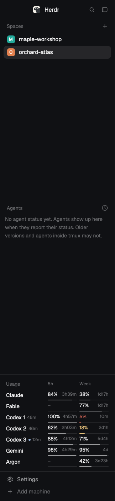

# herdr-token-viewer

A [Herdr](https://herdr.dev) mod that shows how much Claude, Codex and Gemini usage is left,
in the left sidebar below Agents and above Settings. Each row has the share left of the
5-hour and the weekly window and the time until each resets; Codex gets one row per
account that [codex-multi-auth](https://github.com/ndycode/codex-multi-auth) rotates.
Fable and Argon have limits of their own, so each has a row too.



## What it does

- One row each for Claude and Gemini, and one for every Codex account (`Codex 1`,
  `Codex 2`, ...). The account Codex is using now has a small dot.
- `Fable` (under Claude) and `Argon` (under Gemini) show their separate limit. Fable's
  is weekly only, so its 5h column stays `–`. Argon's 5h column shows a share only when a
  5-hour Argon reading is reported; otherwise it stays `–` with an empty bar.
- Each window shows the share **left** (`84%`), the time to its reset (`3h40m`, `1d17h`)
  and a thin bar. The number turns the theme's `working` color under 25% and its
  `blocked` color under 10%.
- A reading older than 3 minutes shows its age beside the name (`46m`, `7h`), and one
  whose time isn't known shows `old`. codex-multi-auth's numbers are the ones it last
  saw, so Codex rows usually have one.
- A window that reset after its reading shows `–` and `reset` instead of an outdated share.
- A provider or account with no reading says `unavailable`; the tooltip says why
  (not set up, sign-in needed, the program is missing, ...). Nothing is guessed.
- Hover a row for the details: plan, exact reset times, the age of the reading and, for
  Codex, the account's masked label.
- It reads again every 2 minutes.
- With the sidebar folded to its rail, each row is one number: the smaller of its two shares.

### Where the numbers come from

The mod runs two programs you already have, and only reads:

| Rows | Program | Notes |
|---|---|---|
| Claude, Fable, Gemini, Argon | `quota-axi --provider claude,agy --json --no-credential-refresh --max-age 60s` | [quota-axi](https://github.com/kunchenguid/quota-axi) asks Anthropic and Google with the sign-ins Claude Code and Antigravity (`agy`) keep on this machine. It is told not to renew a session, so an expired one shows as unavailable until its own CLI renews it. |
| Codex | `codex-multi-auth limits --json` | Every account, from the readings codex-multi-auth last saved (without `--refresh` it answers from its cache). quota-axi sees only the one account Codex is signed in to. |

No token, email address or account id is read by the mod, stored or shown, apart from the
label codex-multi-auth already masks. Without one of the programs, its rows say
`unavailable` and the rest still work.

## Add it

1. Install the two programs and make sure Herdr finds them on your `PATH`.
2. Copy `mods/herdr-token-viewer/` into `~/.config/herdr-app/mods/`.
3. Herdr's own layouts are read-only, so clone the one you use (here `main`):

   ```sh
   herdr-app do layout.clone '{"name":"main","as":"my-main"}'
   ```

4. In `~/.config/herdr-app/layouts/my-main.json`, find the `sidebar` column and add the
   block between `sidebar-lists` (Spaces and Agents) and `sidebar-footer` (Settings):

   ```json
   { "id": "usage", "type": "block", "size": { "px": 226 }, "content": { "mod": "herdr-token-viewer" } }
   ```

   226 px fits seven rows (Claude, Fable, three Codex accounts, Gemini, Argon): 36 for the
   heading, 26 a row, 8 spare. With more rows than fit, the list scrolls.

5. Check it: `herdr-app check ~/.config/herdr-app/mods/herdr-token-viewer`.

The viewer starts with the window, because it is part of the layout.

## Develop

Plain JavaScript, no build step. `mods/herdr-token-viewer/usage.js` holds the reading and
wording rules as pure functions; `main.js` is the view.

```sh
node --test                                     # reading rules
herdr-app check mods/herdr-token-viewer         # loads the mod; also writes gpui-kit.d.ts
tsc -p mods/herdr-token-viewer/jsconfig.json    # type-check against those types
```
