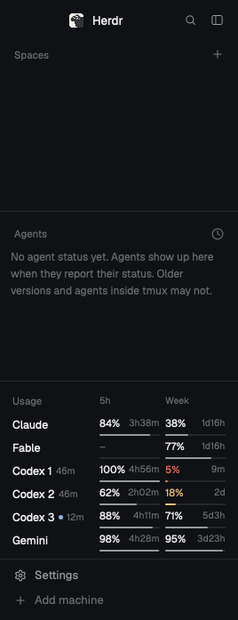

# Usage

A short list in the left sidebar, below Agents and above Settings, that says how much
Claude, Codex and Gemini usage is left: for each, the share left of the 5-hour window and
of the weekly window, and the time until each resets. Codex has one row per account that
codex-multi-auth rotates, with a dot on the one in use. Fable (Claude) has a weekly-only
limit of its own and its own row.

## What you see

- One block as wide as the sidebar (268 px in Herdr's `main`) and 200 px tall, between the
  Spaces/Agents lists and the Settings footer. Background `chrome`, a 1 px `border` line on
  top, like the Agents list above it. 14 px side padding, 12.5 px UI text.
- A heading row, 36 px: `Usage` (11.5 px, medium, `dim`) on the left, then the column
  heads `5h` and `Week` (10.5 px, `dim`), each 68 px wide with 6 px between, over their
  columns.
- Rows, 26 px each, in this order: `Claude`, `Fable`, `Codex 1` ... `Codex n`
  (codex-multi-auth's order), `Gemini`. `Fable` has no 5-hour window: its 5h cell is
  `–` with an empty bar, and its week cell is the usual one.
  - Left: the name (`foreground`; `muted` for a disabled account or a row without a
    reading), then a 5 px round `accent` dot on the Codex account in use, then the
    reading's age (10.5 px, `dim`) once it is 3 minutes old or more (7 minutes for a
    Codex row): `46m`, `7h`, `2d`; `old` when the reading's time isn't known.
  - Two cells, 68 px each: the share left (`84%`, 11.5 px, medium) at the left, the time to
    the reset (10.5 px, `dim`) at the right, and under them a 2 px bar: track `border`,
    filled to the share left.
  - Share left 25% or more: number `foreground`, bar `muted`. Under 25%: both `working`.
    Under 10%: both `blocked`.
  - Times: `<1m`, `42m`, `4h05m`, `2d3h`, `4d`.
- A window whose reset time has passed since the reading: `–` and `reset`, an empty bar.
  A window the source doesn't report: `–`, an empty bar.
- A row without a reading: the name, then `unavailable` (11.5 px, `dim`) across both
  cells. Before the first read comes back: `Claude`, `Fable`, `Codex`, `Gemini`,
  each `reading…`.
- Sidebar folded to its rail (the block narrower than 260 px): no heading; each row is
  centered, 10.5 px: the name's initial plus the account number (`C`, `F`, `C1`, `C2`,
  `C3`, `G`) in `dim`, then the smaller of the row's two shares in its level color, or `–`.
  A stale reading shows its `age()` (`46m`, `old`, ...) in 9 px `dim` on a second line below.

## How it behaves

- Agent status (working, blocked, done, idle) changes nothing here; the list is about
  quota, not agents.
- On start, it runs both programs independently off the UI thread: `quota-axi` every
  120 s (30 s timeout) and `codex-multi-auth` every 360 s (180 s timeout, as it visits the
  accounts one after another, with up to two 15 s calls and a possible token renewal
  each), so a slow call in one never delays the other. `limits --refresh` skips an account
  read less than 5 minutes ago and stamps each account after probing the ones before it;
  the 1-minute margin keeps every account due on each run. A read still in flight isn't
  started twice. Every 60 s it redraws so countdowns and ages move.
- Each read replaces its rows. A failed read shows `unavailable`; an earlier reading is
  never kept to stand in for it.
- Hover a row: a tooltip with the whole reading in one line, for example
  `Claude, max plan. 5-hour: 84% left, resets Thu 14:10. Weekly: 38% left, resets Sat 04:00. Read <1m ago.`
  A `Fable` row says `5-hour: not reported`.
  A Codex row starts with the account's masked label as codex-multi-auth prints it, then
  `in use` and `disabled` where they apply. Reset times are this machine's local time.
  Without a reading: `Gemini: unavailable, sign-in needed.`
- Hover the heading: `Remaining usage per 5-hour and weekly window, with the time to each reset.`
- Why a row is unavailable: the program couldn't be run (`quota-axi could not be run`),
  exited non-zero without a readable report (`... failed (exit 3)`), printed nothing
  readable (`... printed no reading`); quota-axi lists the provider as not set up or
  leaves it out (`not set up on this Mac`), or gives a state other than `fresh` or `stale`
  (`sign-in needed`, `rate limited, try later`, `the read failed`, `no reading available`);
  a Codex account has no saved reading (`no reading yet`); neither window is reported
  (`no 5-hour or weekly window reported`); the provider's reading lacks
  the Fable window (`no weekly window reported`); codex-multi-auth lists no accounts.

## Built from

- Layout: in the `sidebar` column, between `sidebar-lists` and `sidebar-footer`:
  `{ "id": "usage", "type": "block", "size": { "px": 200 }, "content": { "mod": "herdr-token-viewer" } }`.
  Height: 36 + 26 per row + 8 (six rows with three Codex accounts). No `props`.
- `mods/herdr-token-viewer/`: `mod.json` (`{ "place": "none", "title": "Usage" }`),
  `main.js` (the view: rows and rail layout), `feed.js` (shared polling and timers across copies;
  no Herdr imports), `usage.js` (pure rules: reports to rows, rows to texts; no imports),
  `jsconfig.json` (`checkJs`, as Herdr writes it).
- Programs, through `exec` with the person's own `PATH`:
  - `quota-axi --provider claude,agy --full --json --no-credential-refresh --max-age 60s`. From
    `providers[]`: `claude` windows `five_hour` and `seven_day` (Claude) and `model:fable`
    (Fable, weekly only), and `agy` windows `gemini_5h` and `gemini_weekly` (Gemini);
    each window's `percentRemaining` and `resetsAt`; `plan`; `state.status`; `source` and
    `attempts`; the reading's time is `state.refreshedAt`, else the report's `generatedAt`
    only for a `fresh` reading or a positively proven current non-cached successful read.
    `--full --json` preserves `state.refreshedAt`, `source`, and `attempts` so a live `agy`
    reading (which `quota-axi` marks `stale` when an unrelated `claude_gpt_*` window reports
    an epoch reset) keeps its fetch time, and a cached fallback keeps its original
    `refreshedAt`; a stale reading without a time or positive current-read proof shows `old`.
    Other windows (agy's `claude_gpt_*` ones, for example) are ignored.
  - `codex-multi-auth limits --json --refresh`. From `accounts[]`: `index`, `label`, `current`,
    `enabled`, and `quota`: `planType`, `updatedAt`, and in `primary` / `secondary` the
    window with `windowMinutes` 300 (5-hour) and 10080 (weekly): `usedPercent` (shown as
    100 minus it) and `resetAtMs`. Read the windows whatever `status` says: a 429 entry
    is a rate-limited account with real windows, often an exhausted one.
- `herdr`: `exec()`, `theme()`. gpui-kit: `cx.timer.every`, `cx.timer.after`, `cx.spawn`,
  `{ owner: null }` on those (the shared poll outlives the copy that started it), the
  view's `close()` (to leave the shared poll), `.tooltip()`, `.on_size_change()` (its own
  width decides rail or full), `h_flex` / `v_flex` from gpui-base.
- Network: only what `quota-axi` and `codex-multi-auth limits --refresh` do themselves
  (each asks its vendor for the quota; `limits --refresh` can also renew and save Codex
  login tokens). The mod reads no file and persists nothing: beyond the in-memory feed
  its copies share, no stored state, no localStorage.

## Watch out

- quota-axi prints some `resetsAt` times with microseconds (`...00.381247+00:00`); cut
  them to milliseconds before `Date.parse`.
- Go by `windowMinutes`, not by `primary` / `secondary`: a plan with only a weekly window
  reports it as `primary`.
- A Codex reading's `updatedAt` can still be older than the last refresh (for example when
  an account's refresh fails and `codex-multi-auth` falls back to its saved reading).
  Don't show stale readings as current: show the age, and drop a share whose window has
  since reset.
- `--no-credential-refresh` keeps the quota source read-only: quota-axi won't have a vendor
  CLI renew an expired session. Such a provider says `unavailable` until its own CLI
  renews it. The Codex source isn't read-only: `codex-multi-auth limits --json --refresh`
  can renew and save Codex login tokens, so its timeout leaves room for that to finish.
- A report can be valid although the program exits non-zero; read the output first and
  fall back to the exit code only when it isn't a report.
- Gemini's numbers are quota-axi's `agy` (Antigravity) provider; quota-axi has no
  provider for the Gemini CLI.
- Herdr started from Finder takes `PATH` from the login shell. A program only on an
  interactive shell's `PATH` isn't found, and its rows say unavailable.
- All copies of the mod in Herdr (visible or hidden) share one in-memory feed, timers, and
  in-flight read per source. Across separate Herdr processes, `--max-age 60s` lets `quota-axi`
  share one vendor read within a minute, and `codex-multi-auth` coordinates concurrent
  token-refresh and cache writes with its own cross-process locks.
- The block's height is fixed in the layout; with more Codex accounts than fit, the rows
  scroll. Change `px` by 26 per account (and per row added).
- `theme()` is typed `Record<string, string>` but the color setters want `#rrggbb`: cast it
  once (`import("gpui-kit").Color`) or `tsc` reports every color.
- `herdr-app check` builds the view once in a hidden window: it proves the mod loads, not
  that the programs answer. Skip the start read while `checking()` is true (Herdr 0.1.16+)
  so a check runs neither program.

## Done when

- `herdr-app check mods/herdr-token-viewer` passes, `node --test` passes the reading
  rules, and `tsc -p mods/herdr-token-viewer/jsconfig.json` is clean.
- With the block in the sidebar, within a few seconds of start the list shows `Claude`,
  `Fable`, one `Codex n` row per codex-multi-auth account and `Gemini`, between the
  Agents list and Settings. Every row but Fable has two shares, two reset times and two
  bars; Fable has a `–` 5h cell and a weekly share, reset time and bar.
- With quota-axi's reading lacking `model:fable`, the Fable row says `unavailable` while
  Claude still shows numbers.
- A share under 25% is in the `working` color, under 10% in `blocked`, bar included.
- The Codex account codex-multi-auth marks `current` has the dot; a Codex row read 46
  minutes ago shows `46m` beside its name.
- A Codex row whose `resetAtMs` is after its reading and in the past shows `–` and `reset`, not its old share; a `resetAtMs` at or before `updatedAt` keeps the share with no reset time.
- With quota-axi reporting `agy` as `auth_required`, the Gemini row says `unavailable`
  while Claude and Codex still show numbers.
- With neither program on `PATH`, the list is `Claude`, `Fable`, `Codex`, `Gemini`,
  each `unavailable`, and Herdr stays responsive.
- `quota-axi` is run again 120 s after the last read and `codex-multi-auth` every 360 s, not sooner.
- With the sidebar folded, each row is an initial and one number, plus its age underneath when stale.
