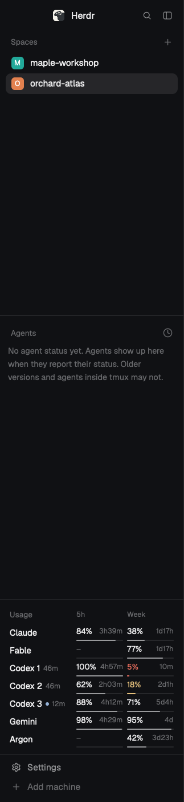

# Usage

A short list in the left sidebar, below Agents and above Settings, that says how much
Claude, Codex and Gemini usage is left: for each, the share left of the 5-hour window and
of the weekly window, and the time until each resets. Codex has one row per account that
codex-multi-auth rotates, with a dot on the one in use. Fable (Claude) and Argon (Gemini)
have a limit of their own and a row each: Fable's is weekly only; Argon's 5-hour window
shows only when one is reported.

## What you see

- One block as wide as the sidebar (268 px in Herdr's `main`) and 226 px tall, between the
  Spaces/Agents lists and the Settings footer. Background `chrome`, a 1 px `border` line on
  top, like the Agents list above it. 14 px side padding, 12.5 px UI text.
- A heading row, 36 px: `Usage` (11.5 px, medium, `dim`) on the left, then the column
  heads `5h` and `Week` (10.5 px, `dim`), each 68 px wide with 6 px between, over their
  columns.
- Rows, 26 px each, in this order: `Claude`, `Fable`, `Codex 1` ... `Codex n`
  (codex-multi-auth's order), `Gemini`, `Argon`. `Fable` has no 5-hour window: its 5h
  cell is `–` with an empty bar, and its week cell is the usual one. `Argon`'s 5h cell is
  the usual one when a 5-hour Argon reading is reported, else `–` with an empty bar.
  - Left: the name (`foreground`; `muted` for a disabled account or a row without a
    reading), then a 5 px round `accent` dot on the Codex account in use, then the
    reading's age (10.5 px, `dim`) once it is 3 minutes old or more: `46m`, `7h`, `2d`;
    `old` when the reading's time isn't known.
  - Two cells, 68 px each: the share left (`84%`, 11.5 px, medium) at the left, the time to
    the reset (10.5 px, `dim`) at the right, and under them a 2 px bar: track `border`,
    filled to the share left.
  - Share left 25% or more: number `foreground`, bar `muted`. Under 25%: both `working`.
    Under 10%: both `blocked`.
  - Times: `<1m`, `42m`, `4h05m`, `2d3h`, `4d`.
- A window whose reset time has passed since the reading: `–` and `reset`, an empty bar.
  A window the source doesn't report: `–`, an empty bar.
- A row without a reading: the name, then `unavailable` (11.5 px, `dim`) across both
  cells. Before the first read comes back: `Claude`, `Fable`, `Codex`, `Gemini`, `Argon`,
  each `reading…`.
- Sidebar folded to its rail (the block narrower than 160 px): no heading; each row is
  centered, 10.5 px: the name's initial plus the account number (`C`, `F`, `C1`, `C2`,
  `C3`, `G`, `A`) in `dim`, then the smaller of the row's two shares in its level color, or `–`.

## How it behaves

- Agent status (working, blocked, done, idle) changes nothing here; the list is about
  quota, not agents.
- On start and every 120 s it runs the two programs, each on its own so the fast one shows
  first, off the UI thread, 30 s timeout each. A read still in flight isn't started twice.
  Every 60 s it redraws so countdowns and ages move.
- Each read replaces its rows. A failed read shows `unavailable`; an earlier reading is
  never kept to stand in for it.
- Hover a row: a tooltip with the whole reading in one line, for example
  `Claude, max plan. 5-hour: 84% left, resets Thu 14:10. Weekly: 38% left, resets Sat 04:00. Read <1m ago.`
  A `Fable` row, and an `Argon` row without a 5-hour reading, says `5-hour: not reported`.
  A Codex row starts with the account's masked label as codex-multi-auth prints it, then
  `in use` and `disabled` where they apply. Reset times are this machine's local time.
  Without a reading: `Gemini: unavailable, sign-in needed.`
- Hover the heading: `Remaining usage per 5-hour and weekly window, with the time to each reset.`
- Why a row is unavailable: the program couldn't be run (`quota-axi could not be run`),
  exited non-zero without a readable report (`... failed (exit 3)`), printed nothing
  readable (`... printed no reading`); quota-axi lists the provider as not set up or
  leaves it out (`not set up on this Mac`), or gives a state other than `fresh` or `stale`
  (`sign-in needed`, `rate limited, try later`, `the read failed`, `no reading available`);
  a Codex account has no saved reading (`no reading yet`); neither window is reported
  (`no 5-hour or weekly window reported`, Argon included); the provider's reading lacks
  the Fable window (`no weekly window reported`); codex-multi-auth lists no accounts.

## Built from

- Layout: in the `sidebar` column, between `sidebar-lists` and `sidebar-footer`:
  `{ "id": "usage", "type": "block", "size": { "px": 226 }, "content": { "mod": "herdr-token-viewer" } }`.
  Height: 36 + 26 per row + 8 (seven rows with three Codex accounts). No `props`.
- `mods/herdr-token-viewer/`: `mod.json` (`{ "place": "none", "title": "Usage" }`),
  `main.js` (the view: timers, the two reads, rows), `usage.js` (pure rules: reports to
  rows, rows to texts; no imports), `jsconfig.json` (`checkJs`, as Herdr writes it).
- Programs, through `exec` with the person's own `PATH`:
  - `quota-axi --provider claude,agy --json --no-credential-refresh --max-age 60s`. From
    `providers[]`: `claude` windows `five_hour` and `seven_day` (Claude) and `model:fable`
    (Fable, weekly only), `agy` windows `gemini_5h` and `gemini_weekly` (Gemini) and
    `gemini_argon_5h` (when reported) and `gemini_argon_weekly` (Argon); each window's
    `percentRemaining` and `resetsAt`; `plan`; `state.status`; the reading's time is `state.refreshedAt`, else for a `fresh` reading
    the report's `generatedAt`. Plain `--json` drops `refreshedAt` unless the reading was
    reused, so a `stale` reading without it is of unknown time and shows `old`. Other
    windows (agy's `claude_gpt_*` ones, for example) are ignored.
  - `codex-multi-auth limits --json`. From `accounts[]`: `index`, `label`, `current`,
    `enabled`, and `quota`: `planType`, `updatedAt`, and in `primary` / `secondary` the
    window with `windowMinutes` 300 (5-hour) and 10080 (weekly): `usedPercent` (shown as
    100 minus it) and `resetAtMs`. Read the windows whatever `status` says: a 429 entry
    is a rate-limited account with real windows, often an exhausted one.
- `herdr`: `exec()`, `theme()`. gpui-kit: `cx.timer.every`, `cx.spawn`, `.tooltip()`,
  `.on_size_change()` (its own width decides rail or full), `h_flex` / `v_flex` from
  gpui-base.
- Network: only what quota-axi does itself (it asks each vendor for the quota). The mod
  reads no file and stores nothing: no shared state, no localStorage.

## Watch out

- quota-axi prints some `resetsAt` times with microseconds (`...00.381247+00:00`); cut
  them to milliseconds before `Date.parse`.
- Go by `windowMinutes`, not by `primary` / `secondary`: a plan with only a weekly window
  reports it as `primary`.
- codex-multi-auth's readings are as old as its last look (`updatedAt`), often an hour.
  Don't show them as current: show the age, and drop a share whose window has since reset.
- `--no-credential-refresh` keeps the mod read-only: quota-axi won't have a vendor CLI
  renew an expired session. Such a provider says `unavailable` until its own CLI renews it.
- A report can be valid although the program exits non-zero; read the output first and
  fall back to the exit code only when it isn't a report.
- Gemini's numbers are quota-axi's `agy` (Antigravity) provider; quota-axi has no
  provider for the Gemini CLI.
- Herdr started from Finder takes `PATH` from the login shell. A program only on an
  interactive shell's `PATH` isn't found, and its rows say unavailable.
- Each Herdr window runs its own copy with its own timers; `--max-age 60s` lets copies
  that read within a minute share one vendor read.
- The block's height is fixed in the layout; with more Codex accounts than fit, the rows
  scroll. Change `px` by 26 per account (and per row added).
- `theme()` is typed `Record<string, string>` but the color setters want `#rrggbb`: cast it
  once (`import("gpui-kit").Color`) or `tsc` reports every color.
- `herdr-app check` builds the view once in a hidden window: it proves the mod loads, not
  that the programs answer.

## Done when

- `herdr-app check mods/herdr-token-viewer` passes, `node --test` passes the reading
  rules, and `tsc -p mods/herdr-token-viewer/jsconfig.json` is clean.
- With the block in the sidebar, within a few seconds of start the list shows `Claude`,
  `Fable`, one `Codex n` row per codex-multi-auth account, `Gemini` and `Argon`, between
  the Agents list and Settings. Every row but Fable has two shares, two reset times and
  two bars; Fable has a `–` 5h cell and a weekly share, reset time and bar, and so does
  Argon when quota-axi reports no `gemini_argon_5h`.
- With quota-axi's reading lacking `model:fable`, the Fable row says `unavailable` while
  Claude still shows numbers; likewise Argon when it lacks both `gemini_argon_5h` and
  `gemini_argon_weekly`.
- A share under 25% is in the `working` color, under 10% in `blocked`, bar included.
- The Codex account codex-multi-auth marks `current` has the dot; a Codex row read 46
  minutes ago shows `46m` beside its name.
- A Codex row whose `resetAtMs` is in the past shows `–` and `reset`, not its old share.
- With quota-axi reporting `agy` as `auth_required`, the Gemini row says `unavailable`
  while Claude and Codex still show numbers.
- With neither program on `PATH`, the list is `Claude`, `Fable`, `Codex`, `Gemini`,
  `Argon`, each `unavailable`, and Herdr stays responsive.
- The programs are run again 120 s after the last read, not sooner.
- With the sidebar folded, each row is an initial and one number.
